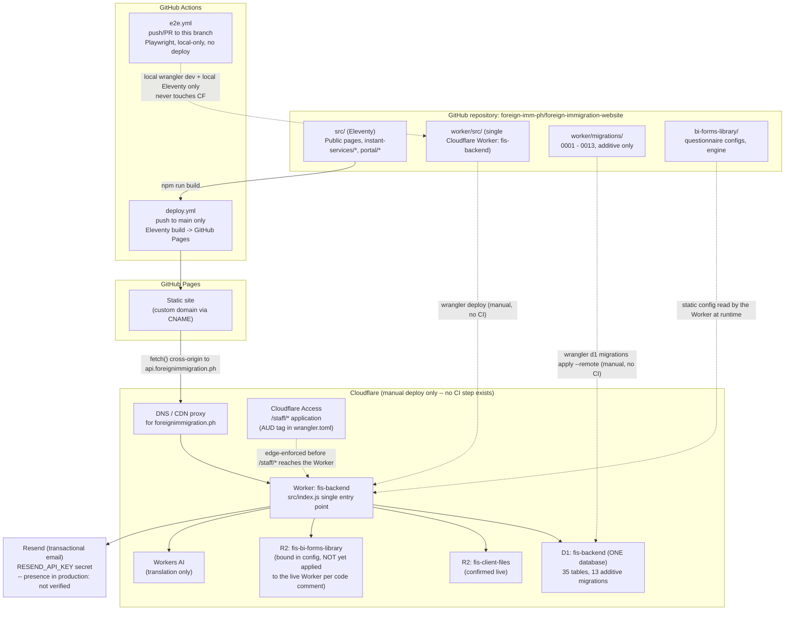
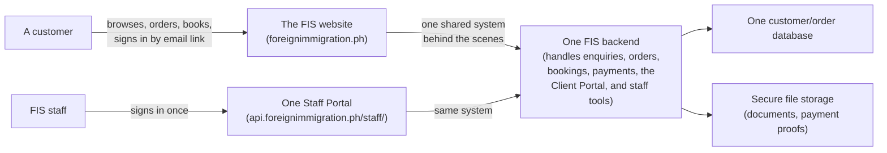

# FIS System Architecture & Launch Readiness — Consolidation Audit

**Repository**: `foreign-imm-ph/foreign-immigration-website`
**Branch audited**: `claude/fis-website-planning-r52sii`
**Commit at time of audit**: `4acd660` (confirmed via `git log -1`; working tree clean)
**Nature of this document**: a read-only audit. No application code, schema, catalogue data, pricing, or infrastructure was changed to produce it. Nothing was deployed.

### How to read this report

Every material claim below is labeled:

- **[REPO]** — verified directly from source, migrations, or config in this repository.
- **[CI]** — verified directly from a committed GitHub Actions workflow.
- **[DOC]** — reported by earlier project documentation, cross-checked against the code where possible.
- **[INFERRED]** — a reasonable conclusion from repo evidence, not itself directly observed.
- **[NOT VERIFIED]** — could not be confirmed this session, and is stated as a limitation, not a fact.

No Cloudflare API token was available in this session's environment (not set as an environment variable, and `wrangler whoami` reports "not authenticated"). Per this audit's own instructions, that absence is reported as a limitation rather than worked around by asking for one to be pasted into chat. **Every claim about what is actually live in production is therefore [INFERRED] or [NOT VERIFIED], never [REPO]**, except where the repository's own CI configuration makes the deployment mechanism itself directly observable.

---

## Part I — Executive explanation

**There is one backend, not two.** `https://api.foreignimmigration.ph/staff/enquiries/` is not a separate system that the newer functionality was bolted onto — it is one route inside the same single Cloudflare Worker (`fis-backend`) that also serves every other staff page, every customer-facing API, document ordering, Airport VIP bookings, the BI Forms Library, and the Client Portal. **[REPO]**

What happened to the original enquiries portal: nothing happened to it. It is still there, still the Staff Portal's home page, and still reachable through the exact same navigation bar as every feature added since. **[REPO]**

Where the new functionality lives: in the same repository, same Worker, same database, under new route prefixes (`/staff/instant-services/*`, `/staff/airport-vip/*`, `/staff/bi-forms/*`) added to the same router that already had `/staff/enquiries/*` and `/staff/applications/*`. **[REPO]**

What is already live: this is the single most important finding of this audit, and it is less than previous reports implied. **No committed CI workflow ever deploys the Worker.** The only deployment automation that exists deploys the public *static site* to GitHub Pages, and only in response to a push to `main` — **[CI]**. The `main` branch is 54 commits behind this development branch, last updated 2026-09-12, and does not contain the Order & Book Online catalogue, Airport VIP, or any Phase 4 work at all — **[REPO]**. The Worker itself is deployed only by a human running `wrangler deploy` directly; there is no record in this repository of when that was last done, so the live state of the Worker cannot be determined from git history — **[NOT VERIFIED]**.

What is still development-only: almost everything built since the original enquiries system — BI Forms Library, Order & Book Online (documents + Airport VIP), catalogue administration, the full Client Portal experience, six-language localization of the portal, and all of Phase 4 — exists only on this development branch and has not been shown, by any evidence available in this repository, to be live. **[INFERRED]**

---

## Part II — Architecture

### A. Technical architecture diagram

### B. Simplified business-owner diagram

There is one website customers use, one Staff Portal employees use, and one system underneath both. The open question is not "how many systems do we have" — it is "which parts of this one system have actually been turned on for real customers yet," and the honest answer today is: very few, because the step that turns any of it on (an actual deployment) has not been recorded as having happened for this newer work.

---

## Part III — Staff Portal map

Every row below is a real route, found by reading `worker/src/routes/staff.js` (the single dispatcher behind everything under `/staff/*`) and the three modules it delegates to (`staffCheckout.js`, `staffAirportVip.js`, `staffBiForms.js`). **[REPO]**

| Page | Route | Purpose | Auth | Dev status | Production status | Navigation |
|---|---|---|---|---|---|---|
| Enquiries (home page) | `/staff/enquiries/` (also the bare `/staff/` root) | View/filter/respond to customer enquiries, convert to an application | Any staff (Cloudflare Access + staff-table allow-list) | Implemented | **[NOT VERIFIED]** — pre-dates this audit's branch divergence; presumed the one part of this system most likely to already be live, but not confirmed | Shared top nav, every page |
| Archived Enquiries | `/staff/enquiries/archived/` | View archived enquiries, restore, permanently delete (admin-only for delete) | Any staff (delete: admin) | Implemented | [NOT VERIFIED] | Shared top nav |
| Applications | `/staff/applications/` and `/staff/applications/:id` | Manage an in-progress application: status, documents, payments, messages, BI Form assignment, communication-channel consent | Any staff | Implemented | [NOT VERIFIED] | Shared top nav |
| BI Forms | `/staff/bi-forms/` and `/staff/bi-forms/:id` | Review a submitted BI Form questionnaire, request revisions, fill staff-only fields, approve, publish the rendered document | Any staff | Implemented; original-template R2 lookup depends on the `BI_FORMS_LIBRARY` binding, which is **not yet applied to the live Worker per the code's own comment** | Not deployed (binding missing) — would 501 on approval if deployed as-is today | Shared top nav |
| Instant Services Orders | `/staff/instant-services/orders/` and `/:id` | Review document/booking orders, verify or reject payment proofs, set delivery status, create delivery quotations | Any staff | Implemented | Not deployed (see Part V) | Shared top nav |
| Instant Services Catalogue | `/staff/instant-services/catalogue/` , `/new`, `/:id` | Create/edit offerings, set prices (with history), approve, activate/pause/archive | **Admin only** for create/edit/status changes | Implemented (Phase 4) | Not deployed | Shared top nav |
| Instant Services Payment Settings | `/staff/instant-services/payment-settings/` | Configure/enable the QR Ph image and customer instructions | **Admin only** | Implemented | Not deployed; no migration pre-seeds this, so even once deployed it starts unconfigured | Shared top nav |
| Airport VIP Bookings | `/staff/airport-vip/bookings/` and `/:id` | Review bookings, confirm availability (separate from payment verification), decide reschedule requests, start/progress refunds | Any staff | Implemented | Not deployed | Shared top nav |

**No separate staff "dashboard" exists.** The root `/staff/` path is an alias for the Enquiries list — that list is the landing page. **[REPO]**

### Administrative consolidation assessment

Staff can move between every one of these functions through one persistent navigation bar, rendered by a single shared layout function (`worker/src/lib/staffHtml.js`'s `staffPage()`), used by every staff page without exception. **[REPO]** There is no fragmentation to fix here — the Staff Portal is already one coherent interface. The only real gap is that, as documented in `docs/OPERATIONAL_READINESS_AUDIT.md` and re-confirmed by this audit, payment verification and refund actions are available to *any* authenticated staff member rather than being role-restricted, while catalogue/pricing changes are admin-only — an inconsistency worth a business decision, not an architectural defect. No change is recommended here beyond what that existing document already flags.

---

## Part IV — Infrastructure map

| Resource | Count / binding | Evidence |
|---|---|---|
| Cloudflare Worker | **One** — `fis-backend`, `worker/wrangler.toml`, `main = src/index.js` | **[REPO]** — only one `wrangler.toml` exists anywhere in the repository |
| D1 database | **One** — binding `DB`, database `fis-backend` | **[REPO]** — one `[[d1_databases]]` block; 35 tables across 13 migrations, every `client_id` foreign key references the same single `clients` table |
| R2 buckets | **Two**, same Worker — `CLIENT_FILES` (`fis-client-files`, customer documents/payment proofs/QR images) and `BI_FORMS_LIBRARY` (`fis-bi-forms-library`, private original templates) | **[REPO]** — CLIENT_FILES used by 7 route/lib files; BI_FORMS_LIBRARY by 2. The wrangler.toml comment states BI_FORMS_LIBRARY "does not exist on the live Worker today" |
| Authentication | **Two deliberately separate systems, one Worker**: Cloudflare Access (edge-enforced JWT, staff only, `/staff/*`) and magic-link + session cookie (customers, app-level) | **[REPO]** — `worker/src/lib/staffAuth.js` (Access) vs `worker/src/lib/session.js`/`routes/auth.js` (customers) |
| Transactional email | Resend, via `worker/src/lib/email.js`; `RESEND_API_KEY` must be a real Worker secret | **[REPO]** code path; **[NOT VERIFIED]** whether a real key is set in production. The code now skips the call entirely (no network request at all) when the key is absent — a deliberate hardening made during Phase 4, not a bug |
| Payment | QR Ph, manual verification only (`worker/src/lib/paymentGateway.js`) — no automated gateway code exists anywhere in this codebase | **[REPO]** |
| Refunds | Simulated workflow records only — explicitly stated in the route's own code comment and in the Staff Portal page text itself | **[REPO]** |
| Workers AI | Translation only (`worker/src/lib/translation.js`) | **[REPO]** |
| GitHub → Cloudflare deploy pipeline for the Worker | **None exists.** | **[CI]** — absence confirmed by reading every workflow file in `.github/workflows/` |
| GitHub → GitHub Pages deploy pipeline for the static site | Exists, triggers only on push to `main` | **[CI]** |

---

## Part V — Development versus production

**A. Live production functionality** — functionality this audit can actually confirm is deployed: **none, with high confidence, from repository evidence alone.** The static site's only deployment path (`deploy.yml`) requires a push to `main`; `main`'s own `src/_data/nav.json` has no Order & Book Online entry and links "Client Portal" only to an informational page, not the working app, and `main` has zero `src/instant-services/` files at all. **[REPO]** Whatever currently answers requests at `https://foreignimmigration.ph` and `https://api.foreignimmigration.ph` could be anywhere from "matches `main`, i.e. Phase 3.1" to "someone manually deployed much more recently" — this repository's history cannot distinguish between those possibilities. **[NOT VERIFIED]**

**B. Development-only functionality** (committed to this branch, no evidence of deployment): BI Forms Library customer/staff workflow, the entire Order & Book Online catalogue (documents + Airport VIP), catalogue/pricing/approval administration, the localized six-language Client Portal, and all of Phase 4. **[INFERRED]**

**C. Partially deployed functionality**: none identified as "partially" deployed in the sense of frontend/backend mismatch, because the evidence points to an all-or-nothing gap (nothing beyond Phase 3.1 appears to have a deployment path at all) rather than pieces of one feature being live while others aren't.

**D. Unverified functionality**: the production state of the ORIGINAL enquiries system itself. It long predates this branch's divergence from `main`, so it may well be live — but this audit has no production access to confirm even that. **[NOT VERIFIED]**

---

## Part VI — Feature reconciliation

| Feature | Evidence | Status |
|---|---|---|
| Original enquiries backend | `worker/src/routes/staff.js` `listEnquiries` et al.; migration `0001_init.sql` | Present, connected, same Worker — production status unverified |
| Staff Portal | `worker/src/lib/staffHtml.js`, `worker/src/routes/staff*.js` | Present, single coherent interface |
| BI Forms Library | `bi-forms-library/`, migration `0009_bi_form_lifecycle.sql`, `worker/src/routes/staffBiForms.js` / `biFormsCustomer.js` | Present; R2 original-template binding not yet applied to any live Worker per source comment |
| Automated document generation | `worker/src/lib/biFormRaster.js` (resvg-wasm), `bi-forms-library/configs/{CCS-A-CDR-2016,2014-13-002,2014-13-006}/` | Present for exactly 3 forms; code-level only |
| Manual document ordering | `document_manual` offering type, `worker/src/routes/checkoutCustomer.js` | Present |
| Airport VIP bookings | Migration `0011_order_and_book_online.sql`, `worker/src/routes/airportVipCustomer.js` / `staffAirportVip.js` | Present |
| QR Ph payment-proof submission | `worker/src/routes/payments.js`, `worker/src/lib/storage.js` | Present; manual verification by design |
| Staff payment verification | `staffCheckout.verifyOrderPayment`, `staff.js markPaymentPaid` | Present; not role-restricted (flagged, Part VIII) |
| Customer receipts | `worker/src/routes/checkoutCustomer.js` `handleGetOrderReceipt` | Present |
| Client Portal | `src/portal/*.njk`, `src/assets/js/portal-*.js` | Present; exists even on `main` but not nav-linked there |
| Six-language localization | `worker/src/lib/clientLocaleStrings.js`, Phase 4's portal STRINGS tables | Present, re-verified this phase via Playwright (Journey 6) |
| Catalogue administration | `worker/src/routes/staffCheckout.js` | Present |
| Offering approval controls | Migration `0013_offering_approval_register.sql`, `setOfferingStatus()` | Present |
| Dynamic pricing / price history | `checkout_price_components`, `checkout_price_history` tables | Present |
| Refund tracking | `airport_vip_refunds` table, `staffAirportVip.js` | Present; simulated only, by design |
| Rescheduling | `airport_vip_reschedule_requests`, `worker/src/lib/airportVipPolicy.js` | Present; 120-hour boundary unit-tested and e2e-tested |
| Delivery quotations | `checkout_delivery_quotations` table, `staffCheckout.createDeliveryQuotation` | Present |
| Automated worker tests | `worker/test/*.test.js` | 249 passing, 2 skipped, 4 todo — re-confirmed this session |
| Playwright browser tests | `e2e/tests/*.spec.js` | 16 passing across 7 journeys as of commit `b1df54d`; unchanged since (confirmed via `git diff --stat`) |
| CI workflows | `.github/workflows/{deploy,e2e}.yml` | Both present; neither deploys the Worker |

This reconciles cleanly against `docs/PHASE4_FINAL_REPORT.md` — nothing in that report's claims contradicts what this audit independently found in source. The one addition this audit makes is the deployment-pipeline finding, which Phase 4's own reports did not focus on because Phase 4 was an implementation phase, not a deployment audit.

---

## Part VII — Catalogue reconciliation

**Only one migration (`0012_phase4_catalogue_expansion.sql`) has ever inserted a row into `checkout_services`.** **[REPO]** This means the oft-cited "16 catalogue entries" were, in every committed and reproducible sense, never real rows — only documentation (`docs/OFFERING_INVENTORY.md`) plus ad-hoc, never-committed `wrangler d1 execute` test rows from past manual sessions. The 19 rows below are the first real, durable catalogue data this system has ever had.

All 19, read directly from the migration (not from any local test database, which accumulates ephemeral Playwright/manual-testing rows that are never committed):

| ID | Title | Type | Category | Status |
|---|---|---|---|---|
| `svc-cdr` | Certificate of Derogatory Record (CDR) | Automated document | `motions-blacklist` | draft |
| `svc-bi-clearance` | BI Clearance Certificate | Automated document | `exit-clearance` (provisional) | draft |
| `svc-travel-records` | Request for Travel Records | Automated document | `document-verification` (provisional) | draft |
| `svc-ext-reconsideration` | Request for Reconsideration on Updating/Extension of Authorized Stay | Manual document | `extensions-compliance` | draft |
| `svc-acr-icard-cert` | ACR I-Card Certification | Manual document | `acr-icard` | draft |
| `svc-travel-pass` | Travel Pass Application | Manual document | `exit-clearance` | draft |
| `svc-ctc-records` | Certified True Copy (CTC) of Records | Manual document | `document-verification` | draft |
| `svc-ecc-application` | Emigration Clearance Certificate (ECC) Application | Manual document | `exit-clearance` | draft |
| `svc-cgaf-immigrant-visa` | CGAF — Immigrant Visa | Manual document | `visa-applications` | draft |
| `svc-ntsp` | Certificate of Not the Same Person (NTSP) | Manual document | `motions-blacklist` | draft |
| `svc-cpa-request` | Certification of Pending Application | Manual document | `visa-applications` | draft |
| `svc-cgaf-student-visa` | CGAF — Student Visa / Special Study Permit | Manual document | `visa-applications` | draft |
| `svc-cgaf-tvv-extension` | CGAF — Extension of Temporary Visitor's Visa | Manual document | `extensions-compliance` | draft |
| `svc-airport-vip-arrival` | Airport VIP Meet & Assist — Arrival | Bookable service | `airport-vip` | draft |
| `svc-airport-vip-departure` | Airport VIP Meet & Assist — Departure | Bookable service | `airport-vip` | draft |
| `svc-airport-vip-roundtrip` | Airport VIP Meet & Assist — Round Trip | Bookable service | `airport-vip` | draft |
| `svc-status-review` | Immigration Status Review | Fixed-price service | `status-review` | draft — **candidate, not a confirmed FIS product** |
| `svc-lost-passport-record-update` | Philippine Immigration Record Update | Manual document | `lost-passport` | draft — **candidate, not a confirmed FIS product** |
| `svc-property-transfer-doc-review` | Property Transaction Document Review & Readiness Check | Fixed-price service | `property-transfer` | draft — **candidate, not a confirmed FIS product** |

Answers to the specific questions asked:

1. The original 16 were documentation only — no catalogue records existed before this phase. **[REPO]**
2. The 19 above. **[REPO]**
3. Added to the pre-existing catalogue system (`checkout_services` and its related tables, built in an earlier phase) — not a separate system. **[REPO]**
4. Yes — the Staff Portal's Instant Services Catalogue pages list every one of them. **[REPO]**
5. Yes — any admin can move each through `draft → approved → active`, and set/update prices with history, via that same Staff Portal page. **[REPO]**
6. Yes, individually — each offering's status is changed one at a time, never in bulk. **[REPO]**
7. Yes — `document_manual`/`fixed_price_service` offerings are explicitly designed to be purchasable with zero automated BI Form mapping; 13 of the 19 are this type. **[REPO]**
8. **Yes, every one of the 19 is still a draft, `active = 0`**, re-confirmed directly against the migration source and separately against a running local database for this audit. **[REPO]**
9. No — none are active in any reproducible/committed state, and (per Part V) there is no confirmed production deployment at all for this feature to be active *in*. **[REPO]+[INFERRED]**
10. No duplicates found; no 19th-vs-16th-entry overlap, since the 16 were never real rows to begin with. **[REPO]**
11. Yes — the public catalogue API (`handleListCatalogue`) only ever returns rows with `active = 1`; a `draft` row additionally 404s on direct lookup by ID, not just omits itself from the list. **[REPO]**
12. Yes — `checkout_services` in the single `fis-backend` D1 database is the only catalogue data store. **[REPO]**

Potentially missing offerings, carried forward from the earlier audit, not expanded here: the 13 "enquiry-first" service categories identified in `docs/OFFERING_INVENTORY.md` were deliberately left out of the catalogue (they remain quotation/enquiry-based), and the three candidate offerings above are explicitly flagged as unconfirmed. No new gaps were found in this audit; expanding the catalogue further is out of this audit's scope by its own instructions.

---

## Part VIII — Operational readiness

Re-verified against `docs/OPERATIONAL_READINESS_AUDIT.md`'s own conclusions; nothing has changed in the relevant source files since that document was written (confirmed via git log on each file).

| Area | Implemented in code | Tested locally | Verified externally | Ready for real customers |
|---|---|---|---|---|
| Transactional email | Yes — 11 templates, Resend wrapper | Yes — mocked in the vitest suite (fixed this phase: no real network call is made even without a key) | No — whether `RESEND_API_KEY` is a real secret in production is **[NOT VERIFIED]** | No, until that secret is set |
| QR Ph payments | Yes — manual-verification-only by design, no automated gateway exists to misuse | Yes — Playwright Journey 1/2/3/7, vitest | No remote verification possible/attempted | No — no migration pre-seeds payment settings; a fresh deploy starts with QR Ph unconfigured until staff set an image |
| Refunds | Yes — simulated workflow only, explicitly stated in code and in the Staff Portal UI itself | Yes — Playwright Journey 5, vitest | N/A (never real money) | Workflow-ready; two open business/access-control questions remain (120-hour re-check at refund time, role-gating) |
| Staff authentication (Cloudflare Access) | Yes, code-level | Dev-only bypass (`DEV_STAFF_BYPASS_EMAIL`), never reachable in a deployed Worker — confirmed by reading the guard itself | Whether the real Access application/AUD tag currently enforces this on the live domain is **[NOT VERIFIED]** | Depends on that unverified external configuration |
| Customer authentication (magic link) | Yes, code-level, session cookie with `Secure`/`SameSite=Lax`/explicit `Domain` | Yes — vitest + every Playwright journey | Depends on `RESEND_API_KEY` for real delivery (see email, above) | Blocked on the same email-secret gap |
| Cloudflare infrastructure | One Worker, one D1, two R2 buckets, Workers AI | Local-only (`--local` bindings throughout) | Not performed this session (no credential) | The `BI_FORMS_LIBRARY` binding is explicitly not-yet-applied; everything else is standard `wrangler.toml` config that takes effect only on an actual deploy |

---

## Part IX — Launch blockers

Evidence-supported, and nothing beyond this:

1. **No automated or recorded path exists to deploy the Worker.** Until someone runs `wrangler deploy` (and applies pending D1 migrations remotely), none of the functionality audited in Parts III–VIII can reach a real customer, regardless of how complete the code is. **[CI]+[REPO]**
2. **The catalogue is empty of purchasable items in any fresh/production database.** Order & Book Online would show nothing to order until at least one offering is approved, priced, and activated. This is by design (draft-first), but it is still a real precondition for the feature to do anything for a customer. **[REPO]**
3. **QR Ph payment settings are unconfigured by default** — no migration seeds them, so checkout cannot reach a payment step until a staff admin uploads a QR image via the Staff Portal. **[REPO]**
4. **`RESEND_API_KEY` must exist as a real secret** before any magic-link, order, payment, or notification email can actually be delivered — today the code deliberately skips the attempt rather than send nothing silently, so the symptom in an unconfigured deploy would be "customers never receive the sign-in email," not a crash. **[REPO]**
5. **The `BI_FORMS_LIBRARY` R2 binding is not yet applied to any live Worker.** If the Worker is deployed with the current `wrangler.toml` as-is, this binding WILL be created (it's declared), but the bucket's actual original-template objects would need to already exist in R2 for BI Form approval to work — the inventory doc records these as already populated out of band in a prior phase, but this session cannot confirm that state is still current. **[DOC]+[NOT VERIFIED]**

None of these are code defects. All five are **sequencing/configuration steps**, not bugs — the kind of thing a deployment runbook (Part XI) exists to walk through, not a reason to write more code.

---

## Part X — Business approvals needed

1. Whether/when to deploy the Worker and merge this branch's static-site changes to `main` at all — nothing here recommends a timeline, only that these are the two gating actions.
2. Which of the 19 draft offerings to actually approve, price, and activate — none are required to go live together.
3. The three candidate offerings (Immigration Status Review, Philippine Immigration Record Update, Property Transaction Document Review) — confirm as real FIS products or archive them.
4. The two ambiguous automated-document category placements (`svc-bi-clearance`, `svc-travel-records`) — confirm or correct before activating either.
5. Airport VIP package prices.
6. Whether payment verification and refund actions should be restricted to admin staff (today, any staff account can do both).
7. Whether the 120-hour Airport VIP policy should be re-checked automatically at refund-creation time, or continue relying on staff judgment as today.
8. Obtaining/confirming a real `RESEND_API_KEY`, and confirming the Cloudflare Access application + AUD tag are correctly configured for `/staff/*` on the real domain.

---

## Part XI — Minimum deployment plan (proposed only — not executed)

1. **Branch**: the Worker can be deployed directly from this branch — `wrangler deploy` does not care which git branch is checked out, only what's on disk. The static site's GitHub Pages pipeline, however, only triggers on `main`, so the site's new pages/nav will not go live without either merging to `main` or adding a deploy trigger for this branch.
2. **Merging to `main`**: necessary only for the static-site GitHub Pages path as currently configured; not technically required to deploy the Worker.
3. **Frontend build**: `npm run build` (Eleventy → `_site/`), already what `deploy.yml` does.
4. **Worker deploy**: `cd worker && wrangler deploy` — a human with real Cloudflare credentials, run manually; applies every binding in `wrangler.toml` including the previously-unapplied `BI_FORMS_LIBRARY` R2 bucket.
5. **Required bindings**: `DB` (D1), `CLIENT_FILES` + `BI_FORMS_LIBRARY` (R2), `AI` (Workers AI), the `CF_ACCESS_*` and `EMAIL_*`/`PUBLIC_SITE_URL` vars already in `wrangler.toml`, plus the `RESEND_API_KEY` secret (`wrangler secret put RESEND_API_KEY`).
6. **Pending migrations**: all 13 are additive (no `DROP`/destructive statement found in any of them — confirmed by reading every migration file). Recommend `wrangler d1 migrations list fis-backend --remote` (read-only) first to see what's actually applied before running `wrangler d1 migrations apply fis-backend --remote`.
7. **Protecting existing production data**: nothing in this migration set deletes or renames a column or table, so applying all pending migrations should be safe to existing rows; the honest caveat is that this session cannot confirm what state the remote database is currently in, so "pending" can only be confirmed by actually listing it first.
8. **Backups/exports**: recommend a `wrangler d1 export fis-backend --remote` before applying any migration remotely, as routine good practice, not because a specific risk was found.
9. **Configuration differences**: compare the live Worker's actual bound variables (via the dashboard or `wrangler deployments list`/`wrangler secret list`) against `wrangler.toml` before deploying, specifically for `BI_FORMS_LIBRARY` and `RESEND_API_KEY`.
10. **Staff access verification**: after deploying, a staff member should sign in through the real Cloudflare Access flow (not the local bypass, which cannot work in a deployed Worker) and confirm they land on `/staff/enquiries/`.
11. **Customer access verification**: a real magic-link round trip, end to end, once `RESEND_API_KEY` is live.
12. **Payment workflow verification**: configure a real QR Ph image via the Staff Portal, then run one real test order through to the proof-upload step (no real money needs to move to verify this far).
13. **Rollback**: Cloudflare Workers support redeploying a previous version directly (dashboard or `wrangler rollback`); since no migration is destructive, no schema rollback should ever be needed, and a Worker-code rollback is safe to leave newer, unused columns in place.
14. **Explicit owner approval required before**: merging to `main`, running any `wrangler deploy`/`wrangler d1 migrations apply --remote` against production, setting the real `RESEND_API_KEY`, uploading a real QR Ph image, or activating any catalogue offering.

---

## Part XII — Final recommendation

**Yes, FIS can proceed toward deployment using the existing architecture.** This audit found no architectural defect, no fragmentation, no duplicated backend, and no database inconsistency that would require consolidation work before launch. The system is already one coherent Worker, one database, one Staff Portal with one navigation bar. What genuinely needs to happen next is not more engineering — it is the deployment sequence in Part XI, plus the business decisions in Part X. The one thing worth treating as a real, standalone finding of this audit — not previously stated this plainly in earlier reports — is that **nothing built since the original enquiries system has a confirmed path to production yet**, because no CI workflow deploys the Worker and `main` has not been updated in over a month. That is a process gap to close deliberately, not a reason to keep building.

---

## Verification limitations

- No Cloudflare API credential was available in this session; every claim about the live Worker, live D1 data, live R2 contents, or live Cloudflare Access enforcement is explicitly labeled [NOT VERIFIED] or [INFERRED] above, never asserted as fact.
- GitHub Pages' actual custom-domain/DNS configuration (vs. the `CNAME` file found in source) was not independently checked against GitHub's own repository settings.
- The 16/16 Playwright result is cited from the immediately preceding development phase's own run, not re-executed in this session; re-confirmed only by `git diff --stat` showing no relevant file changed since that run. The 249/249 vitest result was re-run fresh, independently, during this audit.

## Final version control state at time of this report

- Commit at start of audit: `4acd660`
- This report introduces no code, schema, or data changes — only this file is added.
